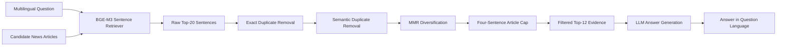

# Multilingual RAG for Cross-Lingual News Question Answering

Python research project developed during the **2026 NSF Virtual REU: Computational Modeling Serving Portland** at Portland State University.

**Researcher:** Zackery Lake  
**Faculty Mentor:** Dr. Ameeta Agrawal  
**Research Area:** Natural Language Processing, Information Retrieval, Multilingual Question Answering, and Retrieval-Augmented Generation

---

## Project Overview

This project investigates multilingual retrieval-augmented generation for cross-document question answering.

The system receives:

- A question in English, Spanish, or Arabic
- A collection of candidate news articles
- Supporting and topically related distractor documents

It then retrieves relevant evidence and generates a concise answer in the language of the question.

The primary evaluation uses the **XRAG benchmark**, which provides multilingual questions, gold answers, supporting articles, distractor articles, and article-level support labels.

The reported 50-question experiment focuses on:

- 25 Spanish questions
- 25 Arabic questions
- Two supporting articles per question
- Six distractor articles per question

The application interface supports English, Spanish, and Arabic, while the main full-sample evaluation reported here uses Arabic and Spanish.

---

## Research Question

> How do retrieval granularity and evidence-budget size affect support recovery and downstream answer quality in multilingual, distractor-heavy, cross-document question answering?

This project specifically examines whether sentence-level retrieval and evidence filtering can reduce the amount of context sent to a language model without substantially reducing answer quality.

---

## System Development

The project progressed through several retrieval and generation configurations.

### Initial Baselines

The baseline experiments included:

1. **BM25 over full articles**
2. **Multilingual E5 over overlapping text chunks**
3. **BM25-E5 reciprocal-rank fusion**
4. **BGE-M3 sentence-level retrieval**

These experiments measured whether each retriever recovered the articles labeled as supporting evidence.

### Final V3 Pipeline

The final evaluated system uses:

```text
Question and candidate articles
            ↓
Sentence segmentation
            ↓
BGE-M3 sentence retrieval
            ↓
Raw Top-20 evidence candidates
            ↓
Exact duplicate removal
            ↓
Semantic near-duplicate removal
            ↓
MMR evidence diversification
            ↓
Maximum four sentences per article
            ↓
Filtered Top-12 evidence sentences
            ↓
LLM answer generation
            ↓
Answer in the question language
```

### Final Configuration

| Parameter | Value |
|---|---:|
| Raw retrieval depth | 20 sentences |
| Final evidence budget | 12 sentences |
| Semantic duplicate threshold | 0.92 |
| Maximum sentences per article | 4 |
| MMR lambda | 0.85 |

The final pipeline reduces the evidence context from 20 sentences to 12 sentences, a **40% reduction**.

---

## Architecture



The current experiments use the candidate articles supplied with each XRAG example. The system does not perform unrestricted live-web retrieval.

---

## Evaluation Metrics

Retrieval and generation are evaluated separately.

### Retrieval Metrics

- **Average support-article recall:** Average fraction of the two labeled support articles retrieved
- **Complete-support coverage:** Questions for which both support articles were retrieved
- **Any-support coverage:** Questions for which at least one support article was retrieved
- **Ranking quality:** How highly supporting evidence appears in the ranked results

XRAG provides article-level support labels. It does not identify one exact gold sentence within each supporting article.

### Generation Metrics

Generated answers were manually scored using a 0–2 scale:

- **2 — Fully correct**
- **1 — Partially correct**
- **0 — Incorrect**

Additional checks included:

- Answer language
- Answer length
- Wrong-number errors
- Incomplete answers
- Wrong-event errors
- Reasoning errors
- Unsupported additions

---

## Main Results

### Retrieval Results

| System | Evidence Budget | Average Support Recall | Complete Support | Any Support |
|---|---:|---:|---:|---:|
| Raw BGE-M3 retrieval | 20 sentences | 0.880 | 40/50 | 48/50 |
| V3 filtered retrieval | 12 sentences | 0.850 | 37/50 | 48/50 |

Filtering retained at least one supporting article for the same 48 questions while reducing the evidence context by 40%.

Complete-support coverage decreased by three questions, showing that aggressive filtering can occasionally remove evidence needed for cross-document reasoning.

### Generation Results

| System | Manual Score | Fully Correct | Partial | Incorrect | Correct Language |
|---|---:|---:|---:|---:|---:|
| V2 raw Top-20 | 73/100 | 32 | 9 | 9 | 50/50 |
| V3 filtered Top-12 | 75/100 | 34 | 7 | 9 | 50/50 |

Additional V3 results:

- Average answer length: **16.24 words**
- Answers longer than 35 words: **2**
- V3 better than V2: **2 questions**
- Tie: **48 questions**
- V2 better than V3: **0 questions**

These results indicate that the filtered system produced comparable or slightly better answers while using substantially less evidence. The results should not be interpreted as a large accuracy improvement because the pairwise comparison was tied on 48 of the 50 questions.

### V3 Error Categories

| Error Category | Count |
|---|---:|
| Wrong number | 6 |
| Incomplete answer | 6 |
| Wrong event | 3 |
| Reasoning error | 1 |

Some questions contained more than one error type.

---

## Repository Structure

```text
reu-2026-multilingual-qa/
│
├── app.py
│   Streamlit interface for running the final multilingual RAG system
│
├── src/
│   Main retrieval, filtering, generation, and evaluation scripts
│
├── data/
│   The evaluated 50-question XRAG sample
│
├── outputs/
│   Retrieval results, generation outputs, summaries, and scored files
│
├── baseline-experiments/
│   BM25, multilingual E5, hybrid retrieval, pilot, and early XRAG tests
│
├── conference/
│   PACLIC 40 LaTeX paper materials and experiment checklist
│
├── presentations/
│   XRAG and multilingual RAG research presentations
│
├── spreadsheets/
│   Manually scored experiment results
│
├── reports/
│   Baseline and model-comparison reports
│
├── earlier-projects/
│   Neural-network and agent-based modeling projects from REU training
│
├── training/
│   Training-period visual aids and presentations
│
├── requirements.txt
│   Python dependencies
│
├── .env.example
│   API-key environment template
│
└── README.md
```

---

## Important Source Files

| File | Purpose |
|---|---|
| `src/rag_system_v1.py` | Initial RAG system |
| `src/evaluate_bge_m3_sentence_retrieval.py` | BGE-M3 sentence-retrieval evaluation |
| `src/rag_system_v2_bge_m3.py` | Raw BGE-M3 retrieval and generation system |
| `src/rag_system_v3_bge_m3_filtered.py` | Deduplication, MMR, and evidence filtering |
| `src/rag_system_v3_generate.py` | Final V3 answer-generation experiment |
| `src/v3_backend.py` | Backend used by the Streamlit application |
| `app.py` | Interactive frontend |

The earlier BM25, multilingual E5, hybrid-retrieval, pilot, and analysis scripts are available under:

```text
baseline-experiments/XRAG_Baseline_Tests/src/
```

---

## Installation

### 1. Clone the repository

```powershell
git clone https://github.com/KcazDev/reu-2026-multilingual-qa.git
cd reu-2026-multilingual-qa
```

### 2. Create a virtual environment

```powershell
python -m venv .venv
.\.venv\Scripts\Activate.ps1
```

### 3. Install dependencies

```powershell
python -m pip install --upgrade pip
pip install -r requirements.txt
```

### 4. Configure the API key

Copy the example environment file:

```powershell
Copy-Item .env.example .env
```

Open `.env` and replace the placeholder:

```text
OPENAI_API_KEY=your_openai_api_key_here
```

The `.env` file is excluded from Git and should never be committed.

---

## Run the Streamlit Application

From the repository root:

```powershell
python -m streamlit run .\app.py
```

The application includes:

- Spanish and Arabic demonstration questions
- Right-to-left Arabic display
- Retrieved-evidence cards
- Retrieval statistics
- Evidence-ranking details
- Final multilingual answer generation

---

## Reproducing the Main Experiments

Run commands from the repository root.

### Evaluate BGE-M3 Sentence Retrieval

```powershell
python .\src\evaluate_bge_m3_sentence_retrieval.py
```

### Run V3 Evidence Filtering

```powershell
python .\src\rag_system_v3_bge_m3_filtered.py
```

### Run V3 Answer Generation

```powershell
python .\src\rag_system_v3_generate.py
```

Configuration constants and output locations are defined near the top of the corresponding scripts.

---

## Dataset Note

The complete XRAG development dataset is not stored in this repository because of its file size and distribution requirements.

The repository includes the 50-question evaluation sample used in the reported experiments:

```text
data/xrag_eval_sample_50.jsonl
```

To run experiments requiring the complete dataset, obtain XRAG from its official distribution and place the development file at:

```text
data/xrag.dev.jsonl
```

That path is excluded by `.gitignore`.

Additional dataset and attribution notes are available in:

```text
baseline-experiments/XRAG_Baseline_Tests/notes/XRAG_License_Notes.txt
```

---

## Limitations

- The primary evaluation contains only 50 questions.
- The evaluated sample contains Arabic and Spanish questions rather than a balanced three-language experiment.
- Generated answers were manually scored.
- Retrieval begins from the candidate articles supplied with each XRAG question.
- Support annotations are article-level rather than exact sentence-level.
- A retriever may recover one support article while missing the second article required for a complete answer.
- Results from this sample should not be generalized to all languages, datasets, or retrieval environments.
- Filtering reduces context but can remove necessary supporting evidence in some cases.

---

## Key Takeaway

The final V3 pipeline reduced the evidence context by 40% while maintaining comparable downstream answer quality on the evaluated sample.

The experiment also shows an important tradeoff: smaller, less repetitive evidence sets can improve efficiency and answer focus, but evidence filtering must be carefully controlled because some multilingual questions require information from multiple supporting documents.

---

## Acknowledgments

This work was completed during the **2026 NSF Virtual REU: Computational Modeling Serving Portland** at Portland State University under the mentorship of **Dr. Ameeta Agrawal**.

The repository also contains projects and learning artifacts produced during the program's computational-modeling training period.

---

## Repository Status

This repository is maintained as a research record for the 2026 REU project.

No open-source license has currently been assigned.